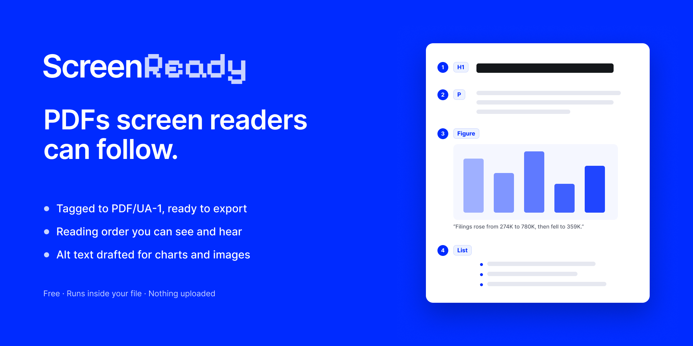

# Screen Ready

A plugin for Figma design that exports your frames as PDFs screen readers can follow: tagged to the
PDF/UA-1 standard (ISO 14289-1), in a sensible reading order, with alt text for images and charts.

Most PDFs exported from a design tool look right but read wrong. A screen reader hears the footer
first, every chart label as a loose word, and no headings to jump between. Screen Ready reads your
frames, suggests the structure, lets you review it, and writes a properly tagged PDF, along with an
accessibility report to keep with it.

Everything runs inside Figma. The plugin has no network access; nothing is uploaded.



## What it does

- **Review**: headings from your type scale and text styles, reading order from your layers (auto
  layout, columns, cards, layers placed over other layers), images, charts, tables and lists, all
  suggested. A short list shows only what needs a person, and most fixes are one click.
- **Preview**: hear what a screen reader will say, page by page, before you export.
- **Export**: one tagged PDF plus an accessibility report.

It handles the awkward cases real files are full of: footers and page numbers (skipped), charts and
diagrams (one figure, alt text drafted from their labels), headings set one layer per line, drop
caps, numbers built from pieces, letters typed apart, invisible or cropped text, bullets drawn as
shapes, tables with two header rows, and right-to-left scripts.

## For the best reading

- Use auto layout for columns and stacks.
- Keep things together: a chart's title and source inside its frame, a caption with its photo.
- Use text styles for headings.
- Keep words as live text, not outlines.
- Name images for what they show.
- Hide what shouldn't be read.

## Develop

Requires Node 22 or later.

```bash
npm install
npm run build
```

In Figma: **Plugins → Development → Import plugin from manifest…** and choose `manifest.json`.
`npm run watch` rebuilds on change.

### Tests

```bash
npm test
```

The main suite (`tools/stress-test.ts`) reads `tools/stress-frames.json`: eleven frames of
deliberately awkward layouts, captured from a Figma page the way the plugin sees them, and checks what
a screen reader would hear. `tools/edge-cases-test.ts` tags real Figma exports in `samples/stress/`.

The PDF/UA checks in the tests use [veraPDF](https://verapdf.org) when it's installed in
`tools/vendor/` (`tools/pdfua.sh`), and are skipped otherwise. `tools/verify.py` and
`tools/readout.py` (Python, with `pikepdf`) check a PDF's structure and print what it reads as.

### Layout

| | |
|---|---|
| `src/code.ts` | The plugin's sandbox side: reads frames and layers from Figma |
| `src/ui.ts`, `src/ui.html` | The panel: review, preview, export |
| `src/tagger.ts` | Turns Figma's PDF export into a tagged PDF |
| `src/suggest.ts`, `src/order.ts` | Role suggestions and reading order |
| `src/structures.ts`, `src/charts.ts`, `src/diagrams.ts`, `src/joins.ts` | Tables, lists, charts, diagrams, split text |
| `src/checks.ts`, `src/contrast.ts` | Content checks and contrast |
| `src/compress.ts`, `src/slim.ts` | Image compression and vector slimming |

## License

MIT, © 2026 Chris Rushing. Icons from [Lucide](https://lucide.dev) (ISC).

Built by Chris Rushing with Claude while at [SpecterOps](https://specterops.io).
